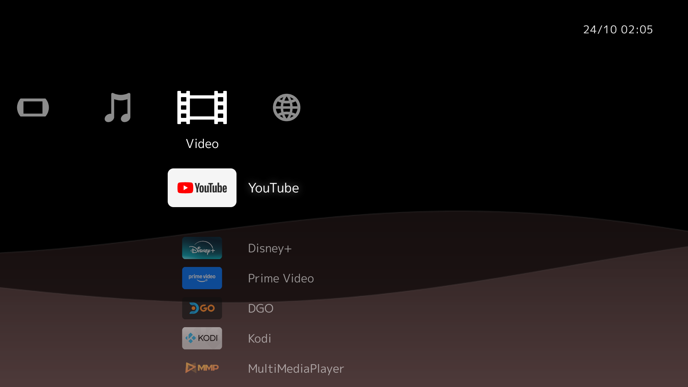

# XMB Home

An XMB-inspired home screen for Android TV / Google TV: the cross bar of the PS3's early (0.83)
firmware, the PSP's slow two-sheet waves, and the PS3's rule for colour (a colour per half month,
brightness that follows the hour, black at night). Made with the
[cleanyourtv](https://github.com/Gathin23/cleanyourtv) prompt, as its own app.



**Built and tested on:** Philips 55PUD7908 (Google TV 14, MediaTek T32, 1080p, ~1.9 GB RAM).

## What it does

- **Cross bar:** Settings · Inputs · Music · Video · Apps. Left/Right moves between categories,
  Up/Down through the column; each column remembers where you were. The item column slides with
  its category icon. Opens on Video.
- **Columns fill themselves:** TV apps from the launcher's app list (Music and Apps by package,
  everything else under Video), HDMI inputs with the names you gave them in TV settings, and Live
  TV.
- **Background:** the PS3's 24 colours (on the 15th and 24th of each month, blending over the three
  days before), brightness by hour, and two translucent sheets drifting in opposite directions.
  30 fps, drawn at half resolution, paused whenever Home isn't on screen.
- **Motion:** a breathing glow on the focused title; a fade with a faint zoom when the screen comes
  on; the reverse when an app opens; Display and Sound settings open over a dimmed Home.
- **Screensaver:** after two minutes without a key, the menu dims to 30% and drifts back to 95%;
  the clock dims, Now Playing stays. The first key only wakes it.
- **Now Playing:** "Now Playing..." next to the clock while audio plays, and under the app that is
  probably playing it (the last one opened from this launcher).

**No permissions at all**: no internet, no notification access, no background service. That is
also why Now Playing can't show song titles: apps like Spotify only share them with apps holding
notification access or with apps they allow-list.

Uses about 55-60 MB while on screen.

## Build and install

Needs JDK 17 and the Android SDK (platform 34, build-tools 34.0.0), and ADB debugging enabled on
the TV.

```bash
TV_HOST=192.168.1.50 ./install.sh
```

This builds a debug APK, installs it next to your current launcher (it doesn't replace anything)
and makes it the Home app. To go back, make your previous launcher Home again, for example:

```bash
adb shell cmd package set-home-activity <your.launcher.package>/.MainActivity
```

On recent macOS the stock `adb` can be blocked from the local network; cleanyourtv's
`tools/tv.py` is a Python ADB client that works around it.

## Making it yours

- `app/src/main/res/values/config.xml`: which packages go in Music and Apps, the first apps in
  Video, and packages to hide.
- Live TV opens the MediaTek TV app (`com.mediatek.wwtv.tvcenter`) through the tuner's passthrough
  URI, which is what works on the 55PUD7908. Other TVs may need a different package in
  `Catalog.java`.

## Credits

Icons, font and trademark notes are in [CREDITS.md](CREDITS.md). In short: most icons are
sah4pok's CC BY 4.0 redraws of Sony's XMB icons, two are drawn by me, and the font is M PLUS 1p
(OFL). PlayStation, PSP and XMB are Sony trademarks; this project isn't affiliated with Sony.

Code: [MIT](LICENSE).
